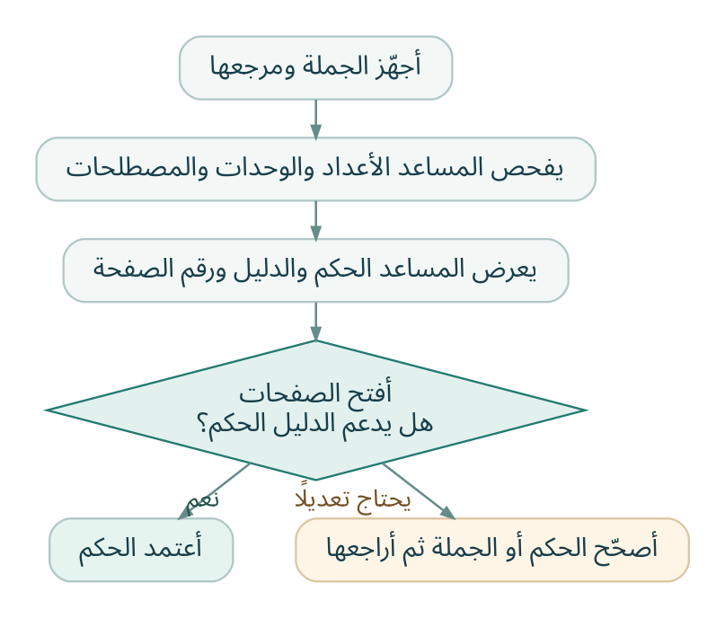

# سير العمل وخطة 30 يومًا

1. أجهّز الجملة والمرجع وأزيل المعرّفات غير اللازمة.
2. يفحص المساعد الأعداد والوحدات والمصطلحات وشروط التجربة.
3. يقترح حكمًا ويعرض الدليل والصفحة لكل جزء مدعوم.
4. أفتح الصفحات. إذا تطابق الدليل أعتمد الحكم، وإذا وجدت نقصًا أصحّح الحكم أو الجملة وأراجعها قبل استخدامها.

أتأكد من ملاءمة المرجع وأزيل المعرّفات الزائدة قبل الإرفاق. أفتح الصفحات بنفسي عند اتخاذ قرار الاعتماد.

## خطة 30 يومًا

| الفترة | الإجراء |
|---|---|
| الأيام 1–7 | أسجّل عدد الجمل التي تحقّقت منها في التقارير والبحوث الجارية. |
| الأيام 8–14 | أسجّل الوقت شاملًا المراجعة وأوثّق التصحيحات. |
| الأيام 15–21 | أراجع الأخطاء المتكررة وأحسّن التعليمات عند الحاجة وأعيد الاختبارات المتأثرة. |
| الأيام 22–30 | أحسب الوفر بناءً على الاستخدام الفعلي وأقارنه بالتقدير الأولي. |

أستمر إذا وفّر المساعد وقتًا واكتمل الدليل في كل جملة اعتمدتها. إذا تكرّر نقص الإحالات، أعدّل التعليمات وأعيد اختبار الحالات المتأثرة.
